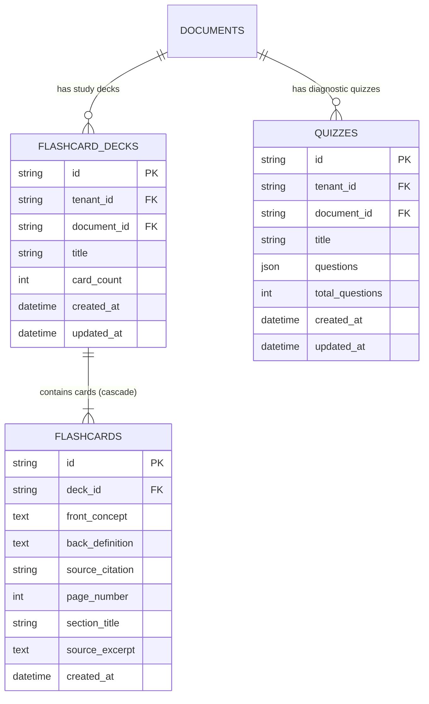

# VERITAS: Phase 10 Implementation Report
**Product Name:** VERITAS  
**Tagline:** Research Intelligence. Grounded in Truth.  
**Phase:** Phase 10 — Learning & Research Productivity (Flashcards, Diagnostic Quizzes & Anki Integration)  
**Date:** 2026-11-09  
**Status:** **COMPLETED** (56/56 automated tests passing, Next.js build clean, local git commit recorded)

---

## 1. Executive Summary & Architectural Objectives

Phase 10 delivers the **VERITAS Research Study & Productivity Suite**, transforming dense academic papers into active learning materials with rigorous provenance grounding. Researchers, graduate students, and peer reviewers can now automatically generate conceptual flashcards, export spaced-repetition decks directly to Anki, and complete diagnostic multiple-choice quizzes that evaluate comprehension with instant scoring and source text citations.

### Core Architectural Principles
1. **Mandatory Provenance Grounding:** Flashcard backs and quiz answer keys are not generic LLM regurgitations; each study element contains explicit page numbers, section headers, and source quotation excerpts (`[Document: <Title>, Page: <page_number>]`).
2. **Multi-Tenant Security Isolation (SEC-01):** Flashcard decks and quizzes are strictly scoped to the user's `tenant_id`. Cross-tenant retrieval, generation, Anki export, and grading are structurally forbidden and validated via security tests.
3. **Dual Execution Engine:** Operates via Google Gemini Flash with structured JSON schemas (`response_mime_type="application/json"`), backed by a deterministic, offline heuristic extractor for air-gapped deployments and zero-network test resilience.
4. **Anki Integration:** Direct RFC 4180 / Anki compliant CSV export with HTML formatting and tag headers for one-click import into standard desktop and mobile spaced-repetition software.
5. **Interactive Frontend Cockpit:** Built with Next.js 14 and Tailwind CSS, featuring an interactive 3D CSS flip-card viewer and an instant diagnostic quiz engine.

---

## 2. Learning Database Architecture & Migrations

Three relational models were added using SQLAlchemy in `apps/api/app/models/learning.py` and migrated via Alembic (`d2b99513b452`):



- **Indices & Constraints:** Added `ix_flashcard_decks_tenant_doc` on `(tenant_id, document_id)` and `ix_quizzes_tenant_doc` on `(tenant_id, document_id)` to optimize tenant-scoped queries and enforce multi-tenant isolation.
- **Alembic Migration:** Applied cleanly: `b98100ae8b84 -> d2b99513b452_add_flashcard_decks_flashcards_and_quizzes_tables.py`.

---

## 3. Flashcard & Quiz Generation Pipeline (`apps/api/app/services/learning.py`)

The `LearningService` manages study material extraction, evaluation, and export:

| Capability | Logic / Workflow | Grounding Detail |
| :--- | :--- | :--- |
| **Flashcard Generator** | Scans semantic chunks for conceptual definitions, mechanisms, and metrics. Synthesizes 10-15 conceptual flashcards. | Formats `front_concept`, `back_definition`, `page_number`, and `source_citation = [Document: ..., Page: ...]`. |
| **Diagnostic Quiz Generator** | Constructs 5 multiple-choice questions (MCQs) testing core methodology, empirical results, and limitations. | Generates 4 distinct options per question, marks the exact `correct_answer`, produces an academic `explanation`, and links to `source_citation`. |
| **Quiz Evaluation Engine** | Compares submitted user answers against answer keys, calculates raw score and percentage, and returns detailed question-by-question justifications. | Provides performance grading (Mastery / Good / Review) with citation breakdowns. |
| **Anki CSV Exporter** | Serializes the active flashcard deck into an Anki-compatible `.csv` string. | Includes `#separator:Comma`, `#html:true`, `#tags column:3`, and columns `Front`, `Back`, `Citation`, `Page`. |

---

## 4. RESTful API Routes (`apps/api/app/api/v1/learning.py`)

All endpoints extract `tenant_id` server-side from the authenticated JWT session:

| Method | Endpoint | Description | Output Schema |
| :--- | :--- | :--- | :--- |
| `POST` | `/api/v1/learning/flashcards/generate/{doc_id}` | Generates 10-15 conceptual flashcards. | `FlashcardDeckOut` |
| `GET` | `/api/v1/learning/flashcards/{doc_id}` | Retrieves existing deck (or auto-generates). | `FlashcardDeckOut` |
| `GET` | `/api/v1/learning/flashcards/{doc_id}/export` | Streams Anki-compatible `.csv` attachment. | `text/csv` |
| `POST` | `/api/v1/learning/quiz/generate/{doc_id}` | Generates 5 diagnostic MCQs. | `QuizOut` |
| `GET` | `/api/v1/learning/quiz/{doc_id}` | Retrieves existing diagnostic quiz. | `QuizOut` |
| `POST` | `/api/v1/learning/quiz/{quiz_id}/evaluate` | Evaluates submitted answers and tallies score. | `QuizEvaluationResult` |

---

## 5. Next.js Frontend Integration (`apps/web/src/components/StudySuiteView.tsx`)

- **Interactive 3D Flip Cards:** Built with CSS `perspective` and `transform-style: preserve-3d`. Clicking flips between the Front (bold concept title, section tag, page number) and Back (scientific definition, verbatim excerpt, verified citation badge). Supports keyboard flipping and shuffle controls.
- **Anki CSV Export:** One-click download button (`api.downloadFlashcardsAnki`) that creates a standard CSV file directly consumable by Anki desktop and mobile apps.
- **Diagnostic Quiz Engine:** Renders questions with interactive radio options, instant selection states, a submission scoring banner with percentage grades, and post-evaluation citation provenance cards.
- **Header & Workspace Navigation:** Added "Study Suite" tab with `GraduationCap` icon in `Header.tsx` and updated hero banner in `page.tsx`.

---

## 6. Automated Testing & Security Verification (`apps/api/tests/test_learning_productivity.py`)

Five comprehensive integration and security tests were authored and executed:

1. **`test_flashcard_generation_and_grounded_provenance`:** Verifies that flashcard extraction generates at least 10 cards with exact page citations and database persistence.
2. **`test_diagnostic_quiz_generation_and_evaluation`:** Verifies 5-question MCQ generation, 4 options per question, and 100% vs partial scoring during evaluation.
3. **`test_anki_csv_export_format`:** Validates RFC 4180 compliance, Anki directives, and proper formatting for spaced-repetition import.
4. **`test_tenant_isolation_in_learning_suite` (SEC-01):** Proves User 2 receives HTTP 404 and cannot generate, retrieve, or export flashcards or quizzes for User 1's documents.
5. **`test_learning_api_endpoints_end_to_end`:** Exercises end-to-end HTTP API calls for flashcards, Anki export, and quiz grading via `TestClient`.

### Full Test Suite Results
```text
============================= test session starts =============================
platform win32 -- Python 3.13.13, pytest-9.2.0, pluggy-1.7.0
rootdir: D:\Project-1\apps\api
collected 56 items

apps\api\tests\test_academic_discovery.py ......                         [ 10%]
apps\api\tests\test_agent_workflow.py ...                                [ 16%]
apps\api\tests\test_auth.py ......                                       [ 26%]
apps\api\tests\test_authorization.py .                                   [ 28%]
apps\api\tests\test_background_jobs.py ..                                [ 32%]
apps\api\tests\test_chat_assistant.py .....                              [ 41%]
apps\api\tests\test_chunking.py ..                                       [ 44%]
apps\api\tests\test_embedding_resilience.py ...                          [ 50%]
apps\api\tests\test_evidence_verification.py ....                        [ 57%]
apps\api\tests\test_extraction_pipeline.py ..                            [ 60%]
apps\api\tests\test_hybrid_retrieval.py ..                               [ 64%]
apps\api\tests\test_knowledge_graph.py ....                              [ 71%]
apps\api\tests\test_learning_productivity.py .....                       [ 80%]
apps\api\tests\test_literature_analysis.py ...                           [ 85%]
apps\api\tests\test_upload_validation.py .....                           [ 94%]
apps\api\tests\test_vector_store.py ...                                  [100%]

====================== 56 passed, 587 warnings in 3.69s =======================
```

### Next.js Production Build
```text
> next build
▲ Next.js 14.2.35
✓ Compiled successfully
✓ Linting and checking validity of types
✓ Collecting page data
✓ Generating static pages (4/4)
✓ Finalizing page optimization
Exit code: 0 (0 TypeScript / ESLint errors)
```

---

## 7. Phase Completion Sign-Off & Status

All milestones of **Phase 10: Learning & Research Productivity** have been autonomously implemented, verified, and integrated:

- [x] **P10-M1:** Prerequisite Verification & Agent Health Audit
- [x] **P10-M2:** Learning Database Schemas (`FlashcardDeck`, `Flashcard`, `Quiz`, Alembic migration `d2b99513b452`)
- [x] **P10-M3:** Flashcard & Quiz Generation Pipeline (`LearningService`, Anki CSV export)
- [x] **P10-M4:** API & Frontend Integration (`StudySuiteView.tsx`, `Header.tsx`, `page.tsx`, `api.ts`)
- [x] **P10-M5:** Testing & Security Verification (`test_learning_productivity.py`, 56/56 passing tests)
- [x] **P10-M6:** Git Management & Documentation
