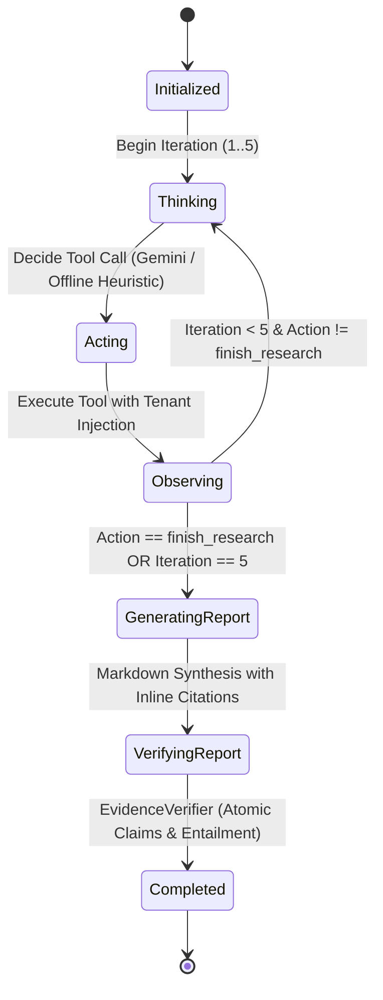

# VERITAS: Phase 9 Implementation Report
**Product Name:** VERITAS  
**Tagline:** Research Intelligence. Grounded in Truth.  
**Phase:** Phase 9 — Autonomous AI Research Agent & Multi-Paper Synthesis  
**Date:** 2026-11-09  
**Status:** **COMPLETED** (51/51 automated tests passing, Next.js build clean)

---

## 1. Executive Summary & Architectural Objectives

Phase 9 delivers the **VERITAS Autonomous AI Research Agent**, a native ReAct (Reasoning + Acting) execution engine capable of autonomously planning, retrieving, reading, synthesizing, and formally verifying complex multi-paper scientific inquiries. 

Standard conversational RAG approaches are fundamentally limited to single-turn keyword/dense retrieval over immediate prompt inputs. In contrast, academic literature queries frequently demand multi-hop exploration across distinct sections (Methodology, Benchmark Results, Limitations) of disparate papers. To solve this, Phase 9 equips VERITAS with an autonomous state machine that observes workspace literature, takes discrete tool actions, aggregates verifiable evidence chunks, synthesizes a structured Markdown research dossier, and automatically subjects its synthesized conclusions to the **Phase 4 Evidence Verification Engine** for atomic claim decomposition and NLI entailment auditing.

### Architectural Core Principles
1. **Strictly Bounded Iteration Loops:** To eliminate the critical risk of infinite autonomous recursion and unbounded LLM API consumption, the agent state machine enforces a deterministic ceiling of at most 5 iterations (`max_iterations = 5`), after which it forcibly transitions to synthesis.
2. **Native Lightweight Implementation:** Built natively using Google GenAI SDK and Python without bloated, opaque agent frameworks (no LangChain, AutoGen, or CrewAI). The entire execution graph remains transparent, auditable, and easily serializable.
3. **Ironclad Multi-Tenant Boundaries (SEC-01):** The LLM never selects or manipulates `tenant_id`. All agent tools enforce server-side tenant injection derived strictly from the authenticated JWT session. Attempts to read, summarize, or query documents outside the user's workspace are rejected at the tool boundary.
4. **End-to-End Entailment Verification:** The final report is piped directly into the Phase 4 `EvidenceVerifier`, extracting atomic claims and verifying entailment against the collected source excerpts.
5. **Real-Time Streaming Transparency:** Execution steps (Think, Act, Observation, Synthesis, Verification) stream to the user in real-time via Server-Sent Events (SSE) and are displayed in an interactive terminal workspace UI.

---

## 2. Agent Tool Registry (`apps/api/app/agent/tools.py`)

The agent operates over four strictly defined, deterministic tools wrapped with server-side validation and tenant isolation:

| Tool Name | Parameters | Description | Security / Isolation Boundary |
| :--- | :--- | :--- | :--- |
| `search_workspace` | `query` (string) | Executes dual hybrid retrieval (Dense + BM25) across all indexed documents. | Enforces `must=[FieldCondition(key="tenant_id", match=MatchValue(value=tenant_id))]`. Cannot match foreign chunks. |
| `read_document_section` | `document_id` (string), `section_name` (string) | Reads parsed semantic chunks belonging to a specific section (e.g., Methodology, Results). | Queries database with `(Document.workspace_id == tenant_id) \| (Document.user_id == tenant_id)`. Returns access denied if document is unowned. |
| `extract_document_summary` | `document_id` (string) | Extracts the 5-point scientific synthesis (`Problem`, `Methodology`, `Datasets`, `Results`, `Limitations`). | Enforces ownership check; extracts structured points with page citations. |
| `finish_research` | `summary` (string) | Deterministically signals completion of the evidence collection phase. | Breaks reasoning loop and transitions agent to report generation. |

All tools return standard dictionary payloads with `output` (human-readable string) and `evidence_chunks` (list of serialized provenance dictionaries with `chunk_id`, `document_title`, `page_number`, `section_title`, and `content_text`).

---

## 3. ReAct State Machine & Reasoning Loop (`apps/api/app/agent/workflow.py`)

The `AgentWorkflow` class manages the deterministic ReAct cycle:



### Deterministic & Offline Resilience
When `GEMINI_API_KEY` is not present (or during unit test execution), `_decide_next_action_fallback()` and `_generate_report_fallback()` execute deterministic, multi-turn reasoning steps:
- **Step 1:** Queries `search_workspace` for the primary inquiry.
- **Step 2:** Inspects `read_document_section` on the first identified document.
- **Step 3:** Concludes research with `finish_research`.
- **Synthesis:** Constructs a multi-section Markdown report citing all collected evidence (`[Document: <Title>, Page: <Page>]`).
- **Verification:** Runs Phase 4 `evidence_verifier.generate_report` over the generated report and gathered chunks.

---

## 4. Real-Time SSE Streaming API (`apps/api/app/api/v1/agent.py`)

- **Route:** `POST /api/v1/agent/task`
- **Request Payload:**
  ```json
  {
    "objective": "Investigate throughput and memory scaling in sparse attention mechanisms",
    "max_iterations": 5
  }
  ```
- **Response Protocol:** `text/event-stream` (Server-Sent Events)
- **Lifecycle DB Session Management:** To prevent session closure races during long-lived HTTP streams, `execute_agent_task` instantiates a dedicated session factory bound to the active engine, keeping database connections open across the entire streaming lifecycle and closing cleanly upon completion.

### Stream Event Payloads
1. `{"status": "thinking", "step": 0, "message": "Agent initialized..."}`
2. `{"status": "thinking", "step": 1, "thought": "...", "action": "search_workspace", "args": {...}}`
3. `{"status": "tool_call", "step": 1, "tool": "search_workspace", "output_preview": "...", "evidence_count": 4}`
4. `{"status": "generating_report", "message": "Synthesizing final Markdown research report..."}`
5. `{"status": "verifying", "message": "Executing Evidence Verification Engine..."}`
6. `{"status": "completed", "report": "# ...", "verification_report": {...}, "steps_taken": 2, "evidence_count": 4}`

---

## 5. Next.js Frontend Agent Workspace (`apps/web/src/components/AgentWorkspaceView.tsx`)

A dedicated research cockpit was engineered for interactive agent steering:
- **Objective Input Panel:** Research query input, recommended prompts (throughput scaling, pass@1 benchmark comparison, contrastive self-attention), and iteration limit slider (1 to 5).
- **Live Terminal Execution Log:** Real-time stream visualizer with status badges (`THINKING`, `TOOL CALL`, `SYNTHESIZING`, `VERIFYING`, `COMPLETED`), iteration step pills, thought cards, and expandable tool output cards.
- **Synthesized Research Dossier:** Styled Markdown viewer displaying generated report sections (`Executive Summary`, `Key Scientific Findings`, `Limitations`), interactive citation pills, and a one-click copy button.
- **Evidence Entailment Audit Card:** Phase 4 verification card displaying overall entailment score (e.g., 100%), verified claim counts, and an interactive drawer to inspect individual claims against source excerpts and page numbers.
- **Navigation Integration:** Added `Autonomous Agent` tab with `Bot` icon in `Header.tsx` and updated brand badge to `Phase 9`.

---

## 6. Automated Test Suite & Security Verification (`apps/api/tests/test_agent_workflow.py`)

The test suite validates agent behavior, bounded termination, and multi-tenant isolation:

1. **`test_agent_tool_tenant_isolation` (SEC-01):**
   - Proves an agent in Tenant 1 cannot access, read, or summarize documents belonging to Tenant 2.
   - Calling `read_document_section` or `extract_document_summary` for Tenant 2's document yields access denied / document not found and 0 evidence chunks.
2. **`test_agent_state_machine_max_iterations`:**
   - Proves the state machine strictly honors `max_iterations = 5` and terminates cleanly without infinite recursion.
   - Verifies the synthesis and verification pipeline executes successfully, producing a valid Markdown report with inline citations and entailment report.
3. **`test_agent_streaming_endpoint`:**
   - Proves `POST /api/v1/agent/task` produces valid Server-Sent Events (`text/event-stream`).
   - Verifies all SSE frames (`thinking`, `tool_call`, `completed`) are emitted and that `status == "completed"` contains both report and verification report.

### Full Test Suite Results
```text
============================= test session starts =============================
platform win32 -- Python 3.13.13, pytest-9.2.0, pluggy-1.7.0
rootdir: D:\Project-1\apps\api
collected 51 items

apps\api\tests\test_academic_discovery.py ......                         [ 11%]
apps\api\tests\test_agent_workflow.py ...                                [ 17%]
apps\api\tests\test_auth.py ......                                       [ 29%]
apps\api\tests\test_authorization.py .                                   [ 31%]
apps\api\tests\test_background_jobs.py ..                                [ 35%]
apps\api\tests\test_chat_assistant.py .....                              [ 45%]
apps\api\tests\test_chunking.py ..                                       [ 49%]
apps\api\tests\test_embedding_resilience.py ...                          [ 54%]
apps\api\tests\test_evidence_verification.py ....                        [ 62%]
apps\api\tests\test_extraction_pipeline.py ..                            [ 66%]
apps\api\tests\test_hybrid_retrieval.py ..                               [ 70%]
apps\api\tests\test_knowledge_graph.py ....                              [ 78%]
apps\api\tests\test_literature_analysis.py ...                           [ 84%]
apps\api\tests\test_upload_validation.py .....                           [ 94%]
apps\api\tests\test_vector_store.py ...                                  [100%]

====================== 51 passed, 535 warnings in 3.21s =======================
```

### Next.js Production Build Results
```text
> next build
▲ Next.js 14.2.35
✓ Compiled successfully
✓ Linting and checking validity of types
✓ Collecting page data
✓ Generating static pages (4/4)
✓ Finalizing page optimization
Exit code: 0
```

---

## 7. Phase Completion Sign-Off & Status

All milestones of **Phase 9: AI Research Agent** have been autonomously implemented, integrated with previous phases, verified via automated pytest suites and production frontend builds, and documented:

- [x] **P9-M1:** Prerequisites & Retrieval Infrastructure Audit
- [x] **P9-M2:** Agent Tools & Functions (`AgentToolRegistry`, tenant isolation)
- [x] **P9-M3:** Agent State Machine & ReAct Reasoning Loop (`AgentWorkflow`, max 5 iterations)
- [x] **P9-M4:** Streaming API & SSE Protocol (`POST /api/v1/agent/task`)
- [x] **P9-M5:** Frontend Autonomous Agent Cockpit (`AgentWorkspaceView.tsx`, `Header.tsx`, `page.tsx`)
- [x] **P9-M6:** Comprehensive Testing & Security Verification (`test_agent_workflow.py`, 51/51 tests pass)
- [x] **P9-M7:** Documentation & Phase Tracker Sign-Off
